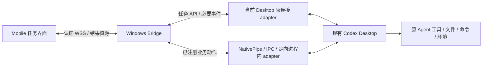

# Mobile Codex App 开发计划

实施状态更新（2026-10-15）：持续 Frida injection、真实 Desktop turn/Plan/用户问题、配对 WSS 和 Flutter 第一版已实现。本文后面的“本轮”“尚未实现”为原设计阶段描述；当前事实以 [验证记录](../p0-verification.md) 为准。

⚡ [Design]: 手机提供任务操作、必要交互和结果查看；Windows Bridge 复用当前 Desktop 的原连接，并只适配这些流程需要的内部能力。电脑继续负责命令、文件、工具和环境执行。

范围版本：0.2；更新日期：2026-10-14。依据本机 Desktop product `26.1007.21434` / build `13901`、CLI `0.162.0-alpha.17.2`。

## 1. 本轮范围

逐项取舍见 [手机功能范围](C:/Users/xiaoyu/Documents/Codex/2026-10-14/new-chat-2/outputs/Mobile-Codex-手机功能范围.md)。147 个原条目中，11 个手机保留、42 个拆分保留、32 个留在主机内部、62 个暂缓桥接。条目计数不是精确 API 数量。

手机首版围绕一个流程：选择电脑已有项目/聊天 → 发送任务 → 看进度 → 回应审批或问题 → 追加方向/停止 → 查看结果和 diff。

| 首版保留 | 处理方式 |
|---|---|
| 设备配对、连接状态、撤销 | 自有 Bridge 机制，主机登录态保留在电脑 |
| 已有项目与聊天列表、聊天读取/新建/恢复 | 主机 adapter 提供手机 view model |
| model、effort、Default/Plan | 只选择当前 backend 支持的值，继承项目环境与权限 |
| 发送、流式回答、简要工具进度 | 复用原 thread/turn 和事件，不单独转发每个工具的底层输出 |
| Steer / Interrupt | 作用于同一 backend 的 live turn |
| command/file/permission 审批、问题、支持的 MCP 表单 | 保留原请求结构与决策语义 |
| 任务 diff、结果附件、必要失败诊断 | 手机原生展示；附件使用绑定任务的资源引用 |
| 断线恢复、请求结果查询 | 事件缓存或 snapshot；结果未知的 mutation 先对账 |

第二批：聊天搜索/Fork/改名/归档/置顶、队列/Goal、Local Automation/Heartbeat、手机通知。根据使用情况逐项加入，不以“API 存在”作为加入理由。

## 2. 暂不开发的 Bridge 功能

| 能力 | 本轮决定 |
|---|---|
| Terminal、PTY、stdin、process 管理 | 不提供直接操作接口；Agent 按原流程执行，手机查看任务状态与必要审批 |
| 文件树、通用 fs API、代码编辑器、IDE、watcher | 不做手机文件管理器；保留 diff 和明确产物 |
| branch/stage/rebase/commit/push、Worktree/Handoff 管理 | 不开发独立控制面；用户可通过聊天明确请求原 Agent 工作流 |
| WSL、environment、roots、provider/API key、账号/config | 在电脑预先配置；手机继承所选项目上下文 |
| subagent、Node REPL、Code Mode、tool discovery、自动审批 | 保持原主机执行路径 |
| Plugins/Skills/MCP 安装与配置、OAuth、Hooks/Instructions 编辑 | 暂缓管理界面；已启用能力仍可供任务使用 |
| Browser/CDP、Computer Use 输入、Office add-in/系统集成控制 | 不对手机提供原始操作接口；结果/审批按任务返回 |
| 文档生成、compiler、Web Search 等内部工具 API | 用聊天任务调用原 Agent；只传结果，不逐个包装工具 |
| Desktop tab/window/layout/focus/theme、Mini/Pets、Windows 设置 | 手机自建 UI；不远程操控这些桌面组件 |
| 实时 Voice、Desktop Dictation/Appshot、完整编辑器 | 暂缓专有 adapter；手机可使用本地键盘语音输入与附件 |
| 官方 Remote relay/pairing、SSH/daemon/exec-server、Cloud 专门控制面 | 自有 Bridge 连接先覆盖指定电脑 |
| 更新/诊断/清理/导入、Memory/Chronicle、条件共享 surface | 不加入本轮手机业务范围 |

范围收缩不关闭 Codex 原能力。例如“运行测试”“生成 PDF”“提交这次修改”仍是正常任务，电脑按原权限选择和执行工具。Bridge 不另写 shell、文件管理或编译器来模拟这些工具。

## 3. 主架构



- 已有 API：内部复用本机 app-server schema；手机只获得注册的业务能力及少量白名单原生方法。
- 未公开能力：先找已有 NativePipe/IPC 入口，必要时在拥有状态的进程内包装单个业务方法。
- Hooks：原事件不足时才加生命周期 adapter，不默认桥接全部事件。
- UI automation/远程桌面：本轮暂缓。保留范围内若确实缺少接口，再评估单个动作的替代路径。

“不公开 API”可通过新增进程内本机接口解决，但外部加载和调用条件要实测。本机函数存在不等于外部 Bridge 已能使用。

## 4. P0：优先验证当前 Desktop

Desktop 实际使用 stdio app-server。另启 `codex.exe app-server` 只能验证独立 backend，不能证明控制了当前窗口的聊天、live turn 或审批。

本机已确认的研究入口：

- preload 暴露 `window.electronBridge`、`sendMessageFromView`、worker send/subscribe 和 shared object snapshot。
- Main 的 `mcp-request` 转发到 `getAppServerConnection(hostId).handleClientRequest(...)`。
- NativePipe 包含 `tools/list` / `tools/call`；已有 `codex-app-tools` 使用它。
- 调用需要 caller/host/thread/turn metadata，NativePipe 有 peer authorization。

P0 验证：

1. 识别当前 host、backend、thread、live turn，并订阅必要状态。
2. 经测试客户端向当前聊天发送任务，Desktop 同步显示并返回流式回答。
3. 原审批请求正确往返，resolved 后双方一致；Steer/Interrupt 正常。
4. 选一个保留范围的 Desktop 专有只读动作，例如查询已有 automation；验证加载方式、身份与上下文。
5. 停用 adapter 后 Desktop 正常；未知 build 不调用未验证私有方法。

先完成技术通路，不必先做手机 UI、Terminal、文件系统或 worktree/compiler adapter。进程内加载、打包/签名限制和 socket 授权尚需 PoC，仍标记 `[unverified]`。

## 5. 协议与权限

完整格式见 [Bridge 协议设计](C:/Users/xiaoyu/Documents/Codex/2026-10-14/new-chat-2/outputs/Mobile-Codex-Bridge-协议设计.md)。

- `backendId` 标识实例，`backendGeneration` 标识连接代次；backend kind 区分 `desktop-shared` / `companion-standalone`。
- `id` 关联请求，`streamId/seq` 关联事件。重连使用缓存或 snapshot；不承诺 exactly-once。
- 审批/用户问题保留原生 id 映射、完整 params/result 和 resolved 状态。内部工具调用、自动审批、token refresh 继续留在原主机路径。
- 通用 `codex.request` 不能绕过范围限制。只有明确 allowlist 的方法和字段可通过，不能直接调用 fs/process/shell/config/任意 tools。
- 手机选择 `projectId` / `threadId`，主机解析 cwd/env/roots 并继承原配置；不能靠提交原生 params 覆盖权限。
- 已有 Full Access 授权按原 Codex policy 执行，不因 Bridge 增加每步重复确认。
- 文件结果使用 task-scoped artifact 引用，不提供任意本机路径 API。
- 电脑内部用当前用户 ACL 保护的 IPC；手机通过配对后的 WSS。MVP 用 LAN/已有 VPN，后续再加 relay/push。
- secrets 留在电脑；设备 token 放系统凭据存储。日志只记录关联 metadata；重放内容缓存与日志分开。

手机首版默认展示回答、计划/状态、必要工具摘要、diff/产物、人工交互。逐字 command output、fs/changed、底层 subagent/hook/debug/reasoning 流不做独立页面或通道；错误中保留必要诊断以便溯源。

## 6. 实现与阶段

建议 Flutter 手机客户端 + TypeScript/Node Windows Bridge。首版使用已有依赖和小型业务 adapters；原生 Windows helper 仅在 PoC 表明需要时加入。

按两名工程师估算，MVP 约 4–6 周；私有接入成本以 P0 结果调整。下面是阶段目标，不是已完成状态。

| 阶段 | 交付 | 验收 |
|---|---|---|
| P0：第 1 周 | Desktop 连接 PoC、一个同聊天操作、一个保留范围的 Desktop 动作 | 同 backend/live turn、正确原审批、可停用恢复 |
| P1：第 2–3 周 | 小型 Bridge registry、配对/WSS、generation、事件与请求记录 | 未配对不可调用、旧 generation 拒绝、排除接口不可走透传 |
| P2：第 3–6 周 | 手机任务 MVP、审批/问题、结果/diff、重连 | 真实任务从发送到结果完整完成，断线不重复执行 |
| P3：MVP 后 | 聊天管理、队列/Goal、Automation/Heartbeat、通知 | 每次加入一个有使用场景的业务流程 |
| P4：按需 | relay、后台推送和明确新增能力 | 不要求补齐暂缓功能，按版本维护已支持 adapters |

不再安排全量 Git/Worktree、MCP 管理、Desktop layout、Voice 或远程桌面的必做阶段。

## 7. 最小项目结构

```text
apps/android/          Android Flutter 设备、项目/聊天、任务、审批、diff/结果
apps/ios/              iOS 原生 SwiftUI 设备、项目/聊天、任务与审批
apps/bridge/           配对、registry、backend 身份、请求与事件
packages/protocol/     envelope、手机 view models、版本类型
adapters/app-server/   保留范围需要的原方法
adapters/desktop/      原连接、NativePipe/IPC 的定向业务动作
adapters/in-process/   仅 PoC 选中的业务 handler 与加载/恢复
docs/                  scope、capability、版本、实测记录
```

没有默认 `terminal/`、`filesystem/`、`worktree-manager/`、`browser-controller/` 或 `remote-desktop/` 模块。

## 8. 核心验证

只验证核心路径：

1. 配对/撤销、范围和字段 allowlist；不能通过原生透传调用已排除方法或改变权限。
2. 当前 Desktop 同一聊天：发送、流式回答、Steer/Interrupt、审批/问题、diff 和产物各一个真实用例。
3. backend 重启、手机断线、重复回复：generation 与 id 关联正确，未知 mutation 不自动重发。
4. 一项 Desktop 专有业务：NativePipe/IPC 身份、上下文、结果和状态同步正确。
5. 支持版本与未知版本、adapter 停用：连接可诊断，Desktop 原流程可继续。
6. 一份 task-scoped 结果附件：有效引用可取，任意路径不能读取；锁屏/睡眠/退出时返回真实状态。

本轮新增的 scope/协议 JSON 和 Markdown 示例应能解析，引用文件存在。设计验证不代替 Bridge 实机验证。

## 9. 交付与依据

当前完成的是范围、开发计划及协议设计。尚未实现可运行 Bridge、手机 App，也未修改/注入 Codex 安装包。

- [147 条功能逐项取舍](C:/Users/xiaoyu/Documents/Codex/2026-10-14/new-chat-2/outputs/Mobile-Codex-手机功能范围.md)
- [范围 JSON](C:/Users/xiaoyu/Documents/Codex/2026-10-14/new-chat-2/outputs/mobile-codex-feature-scope.json)
- [Bridge 协议](C:/Users/xiaoyu/Documents/Codex/2026-10-14/new-chat-2/outputs/Mobile-Codex-Bridge-协议设计.md)
- [Bridge envelope JSON Schema](C:/Users/xiaoyu/Documents/Codex/2026-10-14/new-chat-2/outputs/mobile-codex-bridge-v1.schema.json)
- [本机原始功能清单](C:/Users/xiaoyu/Documents/Codex/2026-10-14/new-chat-2/outputs/Codex本机功能清单.md)
- [本机 app-server API CSV](C:/Users/xiaoyu/Documents/Codex/2026-10-14/new-chat-2/outputs/codex-app-server-api.csv)
- [本机原生 JSON Schema](C:/Users/xiaoyu/Documents/Codex/2026-10-14/new-chat-2/outputs/codex-app-server-schemas.zip)

本地证据来自已提取 ASAR preload/Main、`codex-app-tools/0.1.6/server.mjs` 和生成 schema。包内存在与外部实测接入分开记录。

已核对官方 [App Server](https://learn.chatgpt.com/docs/app-server) 与 [Remote connections](https://learn.chatgpt.com/docs/remote-connections)：原 app-server 为双向 JSON-RPC 风格，省略 `jsonrpc` 字段，stdio 为 JSONL；官方手机配对流程不作为自建 Bridge 的依赖。所查文档没有给出第三方加入官方 relay 的公开 SDK。
